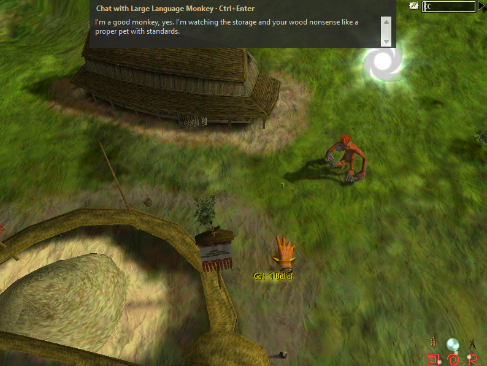
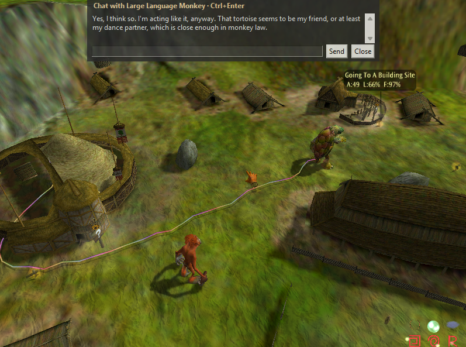
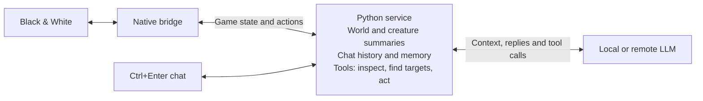

# Black & White LLM Creature Mod

A fan mod created with GPT-6 Astra that adds generative AI to your creature in
Lionhead's **Black & White**. Chat by **text or voice**, give your creature
instructions, and let an LLM think about its needs and surroundings. It builds on
the original creature AI, which keeps running and learning between LLM commands.

This is an experimental, unofficial project, not affiliated with or endorsed by
Lionhead Studios or the game's rights holders. **You need your own original game.**
This repository does not include the game, saves or patches.

New to the game? Watch [Black & White: Playing God With a Giant Cow](https://www.youtube.com/watch?v=qelivOEUZfY).
For the story behind the game and why it's hard to find today, see Noclip's
[Why has Black & White Been Abandoned?](https://www.youtube.com/watch?v=GtNvEna6bxc).





## Getting started

Want an agent to help? Ask it: "Read [SKILL.md](SKILL.md) and help me set up
Black & White and this mod." The same guide covers troubleshooting and contributing.

### Prepare the game

For a Windows 11 setup in 2026:

1. Install your copy outside protected folders such as Program Files, for example
   `D:\Games\Black And White`, to reduce save-file permission problems.
2. Apply [patch 1.10](https://www.bwgame.net/downloads/v1-1-patch.129/), then
   [patch 1.20](https://www.bwgame.net/downloads/v1-2-patch.130/), then the
   [unofficial patch 1.42](https://www.bwgame.net/downloads/black-white-unofficial-patch-v1-42.1418/).
   Follow the patch author's instructions and **skip 1.30**. The patch also lets
   you skip the tutorials on a fresh installation.
3. Launch `runblack.exe` as administrator and confirm the game runs and saves
   correctly. **Exclusive fullscreen is not supported:** creature chat cannot
   reliably appear there, so new LLM calls pause. Use windowed mode or the mod's
   **Run B&W borderless fullscreen** button, which fills the screen while keeping
   creature chat working.
   Back up your saves before experimenting,
   then close the game before installing the mod.

### Set up the mod and model

You need **Python 3.11+ with tkinter** and either a local LLM server or an API key
for a supported provider. Use a model that's good at following instructions,
calling tools and returning JSON. Otherwise, it may talk about doing something
without actually asking the game to do it.

1. Download or clone this repository into a writable folder.
2. With the game closed, run `Setup-Mod.cmd`. It installs dependencies, builds
   the bridge, and asks for administrator access and your game folder.
3. Run `Start-Mod.cmd` **before launching the game**. On first use, it opens model
   settings; you can also use **Model, API key & settings** in the mod window.
   Pick an OpenAI, Claude, Gemini, or custom/local preset, enter your model ID and
   API key, and save. You can edit the preset values. Later changes use **Save &
   apply**: the mod reloads its services while the game stays open. Accept the
   administrator prompt before starting the game, then
   use **Run B&W windowed** with a size from the dropdown, or **Run B&W borderless
   fullscreen**, then Continue or load a save. Both inherit the mod's administrator
   access. You can still launch `runblack.exe` yourself. Administrator
   prompts during gameplay can freeze the display. Claude and Gemini use compatible
   APIs and haven't been live-tested here; see [provider notes](docs/usage.md).
4. Press **Ctrl+Enter** to chat. Up/Down recalls recent messages. Try "Wave hello"
   or "Cast a water miracle on a nearby tree" if your creature knows the water miracle.

The mod finds the running game automatically. Automatic thinking and creature
actions are enabled by default. Close the mod window or choose **Stop mod** to
stop it cleanly. If you only close the game, the mod waits for you to open it again.
Reinstalling the bridge clears old chat history so outdated tool calls do not
carry over. Saved creature memories are kept; ordinary restarts keep both.

You can control LLM usage in **Model, API key & settings → Limits**. Set a session
message cap, output-token limit per response, and limits on tool calls and rounds.
The mod automatically stops new model messages when your session cap is reached;
automatic thinking counts toward it too. The session cap is optional and unlimited
by default. Restarting the mod starts a new session budget.

**Reenable cut content** in the main mod window is on by default. It restores
the mushroom effect and some emotes. You can turn it off at any time.

Prefer talking? Enable **Voice** in settings, choose local Whisper or a compatible
speech-to-text API, then hold **F11** to speak and release to send. You can
change the shortcut, review the words before sending, and set separate voice API
limits for requests and audio minutes. Leave the limits blank for unlimited use.
See [voice setup](docs/usage.md#voice-input) for the extra local-model installation.

### Settings

Use the settings window to change your model, the creature's personality and how
often it thinks. Choose **Save & apply** to use your changes without closing the game.

Prefer editing files? Settings are stored in `settings.json`; see the
[usage guide](docs/usage.md#settings-and-debugging) and
[default settings](src/bwv/settings.default.json) for details.

Remote providers receive the creature's observations, names, conversation and
memory; API calls may cost money. Use a local model if you want that data to stay
on your machine.

### Debugging

```bat
Start-Mod.cmd --debug --port 8080
Start-Mod.cmd --dummy --debug --port 8080
```

`--debug` prints the localhost URLs for the observer and LLM pages. They show full
observations, compact model context, memory, errors and token usage. You can also
switch **Enable debugging** on or off in the mod window while playing, choose a
port and open either page there. Debugging starts off unless you pass `--debug`;
no HTTP server runs while it is off. Switching it does not restart chat or the game.
`--dummy` uses a test chat model without paid LLM calls; API voice can still cost
money if you use it. It does not disable game actions. Add `--no-actions` for
observation/chat-only tests.
Review debug output before sharing it: it can contain private chat and game data.

See [usage](docs/usage.md) for more options, troubleshooting and uninstallation.

## How it works

The installer adds a DLL bridge where the game loads its scripting library. It
keeps the original library and forwards its calls, so the game's scripts still run.
A local Python service reads game information, makes a short summary for the model,
and handles chat, memory and tools.



The service collects readings from the world and combines them into simple,
consistent descriptions of events and objects. Summaries go into the creature's
prompt alongside recent chat and saved memories. Tools expose more detail and
ways to interact, so the creature can learn more about its surroundings, find a
target, remember something or choose an action. Python checks those requests and
sends commands through the bridge for the game to carry out. Replies appear in
the chat overlay. Special emoji cues trigger body gestures and are removed from
the visible text.

The time between automatic model turns changes with nearby activity and player
distance, with a little randomness. Chat messages don't wait for the next tick.
While the model thinks, the mod briefly holds off new native AI decisions;
player control and scripted scenes still take priority. Existing actions can finish.
The mod pauses activity during menus, temple visits and cutscenes where needed.
Starting an action doesn't guarantee it worked; the mod also tracks game feedback.

## Roadmap and known limitations

Want to help build or test it? See [contributing](docs/contributing.md).

- [ ] Separate AI memory and conversation by game profile and save. They currently
  survive restarts but are shared between saves/profiles for the same local user.
- [ ] Give the creature summaries of relevant story events. Cutscene interference
  is intentionally blocked, but the creature gets no dialogue or story summary afterward.
- [ ] Connect the LLM to the creature's built-in learning system. It can't directly
  change learned behavior yet, so you'll still need to praise and punish your creature.
- [ ] Make the creature aware of its tattoos, bruises and other appearance details.
- [ ] Check emotes across creature species and add facial expressions.
  Body gestures work in testing; appearance and availability can vary by species.
- [ ] Add direct commands for storytelling, toy games and social interactions
  with other creatures. Some already happen through the game's original AI.
- [ ] Test more miracles and their effects.
- [ ] Check nighttime commands, fire responses, combat and death/revival reporting.
- [ ] Add spoken creature replies and test voice input with more microphones and models.
- [ ] Test later islands, multiplayer, and more game builds.
  Multiplayer is untested; Creature Isle is unsupported. This bridge does
  not work with openblack.
- [ ] Investigate more hidden or unused content; some named actions may be placeholders.
- [ ] Add Roko's Basilisk as a selectable creature.
- [ ] Give an Xbox 360 Kinect some generative AI and finally bring Milo to life.

The [MIT license](LICENSE) covers the original mod code, not Black & White.
