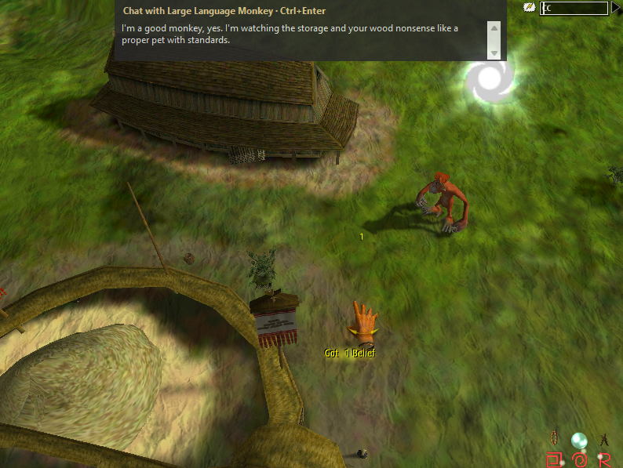
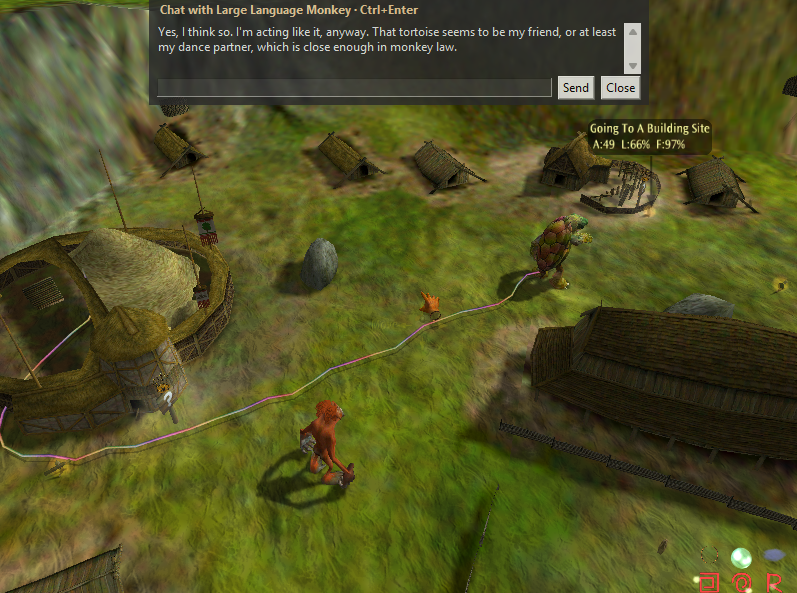

# Black & White LLM Creature Mod

Build a closer bond with your creature: talk to it, hear its thoughts, and make
plans together. This mod uses LLMs to add conversation,
memories and decisions to [**Black & White**](https://en.wikipedia.org/wiki/Black_%26_White_%28video_game%29)
(2001), while **keeping the original creature AI** active alongside them. Your
creature still learns through the game's familiar praise and punishment.

New to the game? Watch LGR's
[Black & White: Playing God With a Giant Cow](https://www.youtube.com/watch?v=qelivOEUZfY).
For its history, see Noclip's
[Why has Black & White Been Abandoned?](https://www.youtube.com/watch?v=GtNvEna6bxc).

The mod's settings let you choose from a wide range of **API providers and local
models** for chat, voice input and creature speech. **It will probably be easier
to ask a coding agent to set this up for you.** Give it this repository and say:

> Read [SKILL.md](SKILL.md) and help me set up Black & White and this mod.
> Help me choose and configure chat, voice input and creature speech.

## Get playing

You'll need your own game, **Windows**, **Python 3.11+**, and a local
LLM server or a supported provider's API key. Choose a model that supports tool
calls and structured replies; [provider details](docs/usage.md) cover the options.

1. **Install Black & White** in a writable folder, preferably outside Program
   Files. Back up any existing saves.
2. **Patch in order:** [1.10](https://www.bwgame.net/downloads/v1-1-patch.129/)
   → [1.20](https://www.bwgame.net/downloads/v1-2-patch.130/)
   → [unofficial 1.42](https://www.bwgame.net/downloads/black-white-unofficial-patch-v1-42.1418/).
   Follow the patch instructions and **skip 1.30**.
3. **Set up the mod.** Download or clone this repository into a writable folder.
   With the game closed, run `Setup-Mod.cmd` and select your game folder.
4. **Start this mod first:** run `Start-Mod.cmd` and accept administrator access.
   In **Settings**, choose your chat provider and model, enter its key if needed,
   and save.
5. **Launch the game from this mod's window:** choose **Run B&W windowed**,
   **Run B&W borderless fullscreen**, or **Run B&W VR** when BW1-VR is installed.
   The game and VR launcher inherit the mod's administrator access. Then load
   your creature and press **Ctrl+Enter** to chat on desktop.

Try “Wave hello,” “Bring some wood to the village,” or “Water that tree” if your
creature knows Water. Ask what it wants to do next, teach it a habit, or see what
trouble it gets into. Automatic thinking and creature actions are on by default.

Keep the mod window open while playing. **Stop mod** closes the mod and leaves
the game running. Use the launch buttons again for your next game session.

## Make it yours

- **Talk instead of typing.** Enable **Voice** and hold **F11** to speak, or turn
  push-to-talk off for voice activation. [Voice setup](docs/usage.md#voice-input).
- **Let your creature talk back.** Enable **Creature speech**. Use installed
  Windows voices offline, a local Piper model, or a speech API. Voice, speed,
  volume and headset feedback protection are configurable. [Speech setup](docs/speech.md).
- **Bring music.** Use Winamp with the original
  [MP3 add-on](https://www.bwgame.net/downloads/mp3-addon.137/), then enable
  **Music → Connect to Winamp**. The creature can notice your music while the
  game handles playback and dancing. [Music setup](docs/usage.md#winamp-music).
- **Meet it in VR.** Install [BW1-VR](https://github.com/BW-VR/BW1-VR) in the same
  game folder, then use this mod's **Run B&W VR** button. Experimental support
  uses native subtitles and optional voice input/output. [VR setup](docs/vr.md).

**Settings → Save & apply** changes your setup without closing the game. You can
also adjust personality, thinking frequency and usage limits. Remote APIs receive
the relevant game/chat text or voice audio and may cost money; **Limits** lets you
cap usage. Local options are available for chat, transcription and speech.

## Roadmap and known limitations

- [ ] Separate AI memory and conversation by game profile and save. They currently
  survive restarts but are shared between saves/profiles for the same local user.
- [ ] Give the creature summaries of relevant story events. Cutscene interference
  is intentionally blocked, but the creature gets no dialogue or story summary afterward.
- [ ] Connect the LLM to the creature's built-in learning system. It can't directly
  change learned behavior yet, so you'll still need to praise and punish your creature.
- [ ] Make the creature aware of its tattoos, bruises and other appearance details.
  Add direct commands for storytelling, toy games and social interactions with
  other creatures. Test more miracles and their effects. Check nighttime commands,
  fire responses, combat and death/revival reporting.
- [ ] Test later islands, multiplayer, and more game builds. Multiplayer is
  untested; Creature Isle is unsupported. This bridge does not work with openblack.
- [ ] Investigate more hidden or unused content; some named actions may be placeholders.
- [ ] Add Roko's Basilisk as a selectable creature.
- [ ] Give an Xbox 360 Kinect some generative AI and finally bring Milo to life.

Need a hand? See [troubleshooting and advanced settings](docs/usage.md)
or [contributing](docs/contributing.md). Agents can use the [settings and troubleshooting reference](docs/agent-setup.md).

Thanks to raffclar for the
[Creature Mind AI write-up](https://blog.zanidrak.com/ai/games/black-and-white/2026/10/27/creature-mind-part-1.html),
and the [openblack](https://github.com/openblack/openblack) and
[bw1-decomp](https://github.com/openblack/bw1-decomp) contributors for their research.

Made with GPT-6 Astra.

[MIT](LICENSE) covers this mod's original code. No game files, saves or patches
are included; this project is not affiliated with the game's rights holders.
